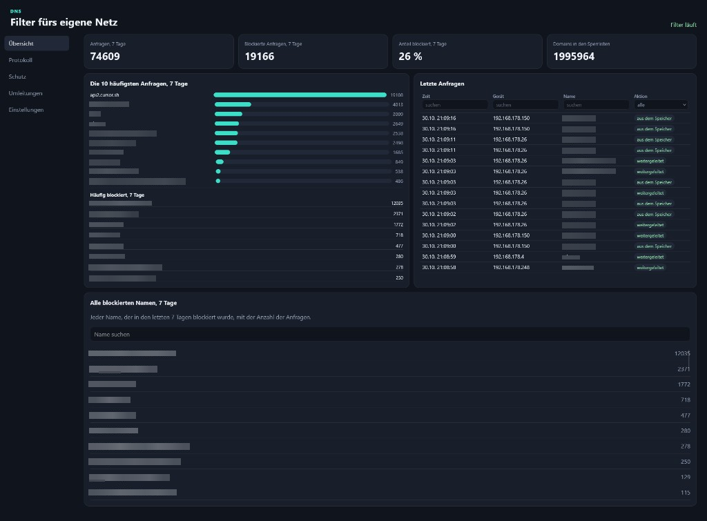

# DNS-over-HTTPS Filter

Der Filter sperrt Namen, bevor ein Gerät sie auflöst. Damit wirkt er im ganzen Netz als Werbeblocker: Werbung, Zählpixel und Tracker, die einen eigenen Namen haben, werden nicht mehr abgerufen. Voreingestellt sind die Sperrlisten HaGeZi Pro und HaGeZi TIF. Zusätzlich lassen sich einzelne Namen immer sperren oder immer erlauben. Die Sperre gilt für jedes Gerät, das diesen DNS-Server benutzt, also für Handy, Fernseher und Rechner, ohne Zusatzprogramm im Browser.

Anzeigen, die vom selben Namen kommen wie die Seite selbst, bleiben stehen. Der Filter sieht nur den Namen der DNS-Anfrage, nicht den Inhalt der Seite.

Die Anfragen gehen verschlüsselt per DNS-over-HTTPS an den eigenen Server. Der Provider sieht dabei nicht, welche Namen abgefragt werden. Die spätere Verbindung zur Seite sieht er weiter, einschließlich der Zieladresse.

Der Filter läuft auf einem Linux-Server mit öffentlicher Adresse. Die Geräte fragen den Router, und der Router schickt die Anfrage per DNS-over-HTTPS an den Server. Der Server prüft die Sperrlisten und löst den Namen über einen lokalen Resolver auf. Ein Weiterleiter auf dem Router ist dafür nicht nötig. Er schreibt nur zusätzlich die LAN-Adresse des Geräts in die Anfrage, damit im Protokoll das einzelne Gerät steht und nicht die öffentliche Adresse des Anschlusses.



Die Beispiele unten heißen `beispiel.domain`, `dns.beispiel.domain`, `dein_username`, `203.0.113.10` und `192.168.1.250`. Das sind Platzhalter. Vor dem ersten Befehl die eigenen Werte einsetzen und danach überall dieselben verwenden.

| Wert | Beispiel | Bedeutung |
| --- | --- | --- |
| `HOSTNAME` | `beispiel.domain` | Name im Zertifikat und in der DoH-Adresse |
| `ADMIN_HOST` | `dns.beispiel.domain` | Name der Weboberfläche |
| `ADMIN_USER` | `dein_username` | Anmeldung der Oberfläche und Linux-Benutzer |
| `PUBLIC_IP` | `203.0.113.10` | Öffentliche IPv4-Adresse des Servers |
| `LAN` | `192.168.1.0/24` | Netz der Geräte |
| `ROUTER` | `192.168.1.1` | Adresse des Routers in diesem Netz |
| `FORWARDER` | `192.168.1.250` | Freie Adresse für den Weiterleiter |
| `BRIDGE` | `bridge` | Bridge, an der das LAN hängt |
| `DISK` | `usb1` | Beschreibbarer Speicher auf dem Router |

Der Router in dieser Anleitung ist RouterOS auf ARM64, zum Beispiel eine RB5009. Der Weiterleiter ist ein Container auf diesem Router.

Blöcke mit `bash` im Terminal des Linux-Servers ausführen, als root. Blöcke mit `routeros` im Terminal der RB5009 ausführen. Blöcke ohne diese Überschrift sind Dateien und werden nicht ins Terminal eingefügt.

## 1. Handarbeit

Das erledigen die Skripte nicht.

1. Ein Debian- oder Ubuntu-Server mit öffentlicher IPv4-Adresse. In den Beispielen heißt sie `203.0.113.10`.
2. Beim Anbieter der Domain zwei A-Einträge auf diese Adresse: `beispiel.domain` und `dns.beispiel.domain`. Beide müssen stehen, bevor das Zertifikat beantragt wird.
3. Aus dem Internet erreichbar: TCP 80 für die Zertifikatsprüfung, TCP 443 für die Oberfläche, TCP 8443 für DNS-over-HTTPS vom Router. Port 53, Port 5300 und Port 8090 bleiben zu. Steht der Server hinter einer weiteren Firewall, dort dieselben drei Ports freigeben.

   Prüfen auf einem anderen Rechner im Internet, nicht auf dem Server und nicht auf der RB5009. `nmap` muss dort installiert sein. Im Terminal dieses Rechners ausführen:

   ```bash
   nmap -Pn -p 80,443,8443,53,5300,8090 203.0.113.10
   ```

   In der Spalte STATE steht einer von drei Werten:

   - `open`: der Port ist erreichbar und ein Dienst antwortet.
   - `closed`: der Port ist erreichbar, es antwortet kein Dienst.
   - `filtered`: eine Firewall verwirft die Pakete. Der Port ist von außen nicht erreichbar.

   Vor den Skripten dürfen 80, 443 und 8443 noch `closed` sein, weil Apache und der Filter noch nicht laufen. `filtered` bei diesen drei Ports heißt, die Firewall lässt sie noch nicht durch. Nach `prepare.sh` und `install.sh` müssen 80, 443 und 8443 `open` sein. 53, 5300 und 8090 bleiben `closed` oder `filtered`.

4. Das Repository auf den Server holen. Im Terminal des Linux-Servers ausführen:

```bash
git clone <Repository-Adresse> /home/dein_username/dns-filter
```

`dein_username` ist der Linux-Benutzer, dem der Ordner gehört. Diesen Pfad danach überall in der Anleitung mit dem eigenen Benutzernamen verwenden. Der Ordner bleibt an dieser Stelle liegen. Die Oberfläche liest `static/` aus dem Verzeichnis, in dem der Filter gebaut wurde.

## 2. Eigene Werte

Einmal die Datei `deploy/site.env` im geklonten Ordner auf dem Linux-Server ausfüllen. Das ist eine Datei, kein Befehl fürs Terminal. `prepare.sh`, `install.sh` und `apache-admin.sh` lesen sie.

```bash
HOSTNAME=beispiel.domain
ADMIN_HOST=dns.beispiel.domain
ADMIN_USER=dein_username
```

`beispiel.domain` ist der Name für das Zertifikat und für DNS-over-HTTPS. `dns.beispiel.domain` ist nur die Weboberfläche. `dein_username` ist der Anmeldename der Oberfläche.

Solange dort noch die Platzhalter stehen, brechen die Skripte ab. Danach im Terminal des Linux-Servers ausführen:

```bash
sudo /home/dein_username/dns-filter/deploy/prepare.sh
sudo /home/dein_username/dns-filter/deploy/install.sh
sudo /home/dein_username/dns-filter/deploy/apache-admin.sh
```

`prepare.sh` endet mit dem Hinweis auf `install.sh`. `apache-admin.sh` gibt Benutzer und Passwort einmal aus. Beides notieren. Ein zweites Ausführen dieses Skripts lässt die vorhandene Anmeldung stehen.

Der Server ist bereit, wenn diese Prüfungen stimmen. Im Terminal des Linux-Servers ausführen:

```bash
systemctl status unbound dns-server
curl -sS -o /dev/null -w '%{http_code}\n' http://127.0.0.1:8090/
curl -sk -o /dev/null -w '%{http_code}\n' https://beispiel.domain:8443/
```

Unbound und der Filter sind aktiv. Die lokale Oberfläche antwortet mit `200`. Port 8443 antwortet mit `404`, weil die Adresse ohne Token keine DNS-Anfrage ist. Damit ist der Port offen.

Im Browser `https://dns.beispiel.domain/` öffnen und mit dem notierten Benutzer anmelden. Unter **Sperrlisten** stehen HaGeZi Pro und HaGeZi TIF. Eingeschaltete Listen lädt der Dienst beim Start und danach alle 6 Stunden. Bis eine Namenszahl und ein Stand erscheinen, ist diese Liste noch leer. Der Server braucht dafür ausgehendes HTTPS.

In der Weboberfläche den Menüpunkt **Einstellungen** öffnen. Dort steht ein Abschnitt mit der Überschrift **RB5009**. Die Zeile direkt darunter ist die DoH-Adresse, zum Beispiel `https://beispiel.domain:8443/<Token>`. Diese Zeile kopieren. Dieselbe Adresse bekommen im nächsten Abschnitt der Router und der Weiterleiter.

## 3. RB5009

Damit anfangen, wenn die Prüfungen aus Abschnitt 2 gelingen und die DoH-Adresse vorliegt.

Der Filter funktioniert ohne den Weiterleiter. Die Geräte fragen den Router, der Router fragt den Server per DNS-over-HTTPS. Gesperrte Namen bleiben gesperrt, und der Provider sieht die Namensabfragen nicht. Im Protokoll steht dann bei jedem Gerät die öffentliche Adresse des Anschlusses.

Soll im Protokoll die LAN-Adresse des einzelnen Geräts stehen, kommt der Weiterleiter dazu. Das ist der Container ab Abschnitt 3.1. Die Geräte fragen dann ihn, und er schreibt die Absenderadresse in die Anfrage. Ohne diesen Wunsch die Abschnitte 3.1 bis 3.3 auslassen.

Die Uhr der RB5009 muss stimmen, sonst lehnt sie das Zertifikat ab. Im Terminal der RB5009 ausführen:

```routeros
/system ntp client set enabled=yes
/system clock print
```

Der DNS-Dienst von RouterOS filtert ebenfalls, schreibt aber die Adresse des Geräts nicht mit. Im Protokoll steht dann die öffentliche Adresse des Anschlusses. Der Container auf `192.168.1.250` hört im LAN auf Port 53, übernimmt die Absenderadresse und fragt den Server per DNS-over-HTTPS.

### 3.1 Container-Paket

Diesen Abschnitt und die beiden folgenden nur ausführen, wenn im Protokoll die LAN-Adresse jedes Geräts stehen soll.

Das Paket muss zur installierten RouterOS-Version und zur Architektur passen. Für RouterOS 7.24.5 auf ARM64 liegt es im Repository als `deploy/container-7.24.5-arm64.npk`. Für eine andere Version das Extra-Paket `container` von [mikrotik.com/download](https://mikrotik.com/download) holen.

1. Die `.npk`-Datei in **Files** auf den Router kopieren.
2. Router neu starten.
3. Container erlauben. RouterOS verlangt danach einen Neustart und innerhalb weniger Minuten das Ausschalten oder den Mode-Knopf. Im Terminal der RB5009 ausführen:

```routeros
/system device-mode update container=yes
```

4. Prüfen. `container` ist erlaubt, das Paket ist aktiv. Im Terminal der RB5009 ausführen:

```routeros
/system device-mode print
/system package print where name=container
```

### 3.2 Adresse

`192.168.1.250` muss frei sein und im LAN liegen. `bridge` ist die Bridge mit der Adresse `192.168.1.1`. Beides vorher ablesen. Im Terminal der RB5009 ausführen:

```routeros
/ip address print
/interface bridge print
/ip dhcp-server lease print
```

Im Terminal der RB5009 ausführen:

```routeros
/interface veth add name=veth-dns address=192.168.1.250/24 gateway=192.168.1.1
/interface bridge port add bridge=bridge interface=veth-dns
```

Das Gateway ist `192.168.1.1`, damit der Container den Server auf Port 8443 erreicht.

### 3.3 Image starten

`deploy/lan-forward-rb5009.tar` ist ein Linux-Image für ARM64. Der Startbefehl darin ist `/lan-forward`. Die DoH-Adresse kommt über `DOH_URL`.

Die Tar-Datei auf den Router kopieren. Den Speicher ansehen und `usb1` ersetzen. Im Terminal der RB5009 ausführen:

```routeros
/disk print
/container config set ram-high=128M
/container envs add list=lan-forward key=DOH_URL value="https://beispiel.domain:8443/<Token>"
/container add file=lan-forward-rb5009.tar interface=veth-dns envlist=lan-forward root-dir=usb1/lan-forward start-on-boot=yes logging=yes
/container start [find interface=veth-dns]
```

Im Terminal der RB5009 ausführen:

```routeros
/container print
/log print where topics~"container"
```

Der Container läuft, und im Log steht, dass er auf `0.0.0.0:53` hört. Vom LAN aus muss `192.168.1.250` auf UDP und TCP 53 antworten.

Eine zusätzliche lokale Sperrliste ist möglich: eine Textdatei, ein Name pro Zeile, höchstens 500 Namen, im Container unter `/sperre/liste.txt`. Ohne diese Datei fragt er jede Anfrage beim Server an.

### 3.4 DNS des Routers

Zuerst den statischen Namen, danach DNS-over-HTTPS. Der Router muss `beispiel.domain` auflösen können, bevor die DoH-Verbindung steht. Die Adresse ist `203.0.113.10`. Zeigt die Oberfläche dort eine private Adresse, die öffentliche Adresse des Servers eintragen. Läuft der Filter im selben LAN wie der Router, hier die LAN-Adresse des Servers eintragen und Port 8443 dorthin erreichbar machen.

Dieselben drei Befehle stehen in der Weboberfläche unter **Einstellungen** im Abschnitt **RB5009**, unter der DoH-Adresse. Im Terminal der RB5009 ausführen:

```routeros
/ip dns static add name=beispiel.domain address=203.0.113.10
/ip dns set allow-remote-requests=yes use-doh-server="https://beispiel.domain:8443/<Token>" verify-doh-cert=yes servers=""
/certificate settings set crl-use=no
```

`servers=""` entfernt andere Weiterleitungen. `verify-doh-cert=yes` prüft das Let's-Encrypt-Zertifikat. `crl-use=no` überspringt den Abruf der Sperrliste der Zertifizierungsstelle. Der bleibt auf RouterOS oft hängen, und die DoH-Verbindung kommt dann nicht zustande.

### 3.5 DHCP

Ohne Weiterleiter bekommen die Geräte den Router als DNS-Server. Im Terminal der RB5009 ausführen:

```routeros
/ip dhcp-server network set [find address=192.168.1.0/24] dns-server=192.168.1.1
```

Mit Weiterleiter bekommen sie den Container. Im Terminal der RB5009 ausführen:

```routeros
/ip dhcp-server network set [find address=192.168.1.0/24] dns-server=192.168.1.250
```

Nur eine der beiden Zeilen ausführen. Danach im Terminal der RB5009 prüfen:

```routeros
/ip dhcp-server network print
```

In der Ausgabe steht die gewählte Adresse. Bestehende Leases behalten den vorigen DNS-Server bis zur Erneuerung. Danach auf einem Gerät die Lease erneuern oder neu starten.

Ein fest eingetragener DNS-Server, privates DNS auf dem Handy und DNS-over-HTTPS im Browser verwenden diesen DHCP-Eintrag nicht. Diese Anfragen gehen am Filter vorbei.

### 3.6 Gesamten Weg prüfen

1. Auf einem DHCP-Gerät steht als DNS-Server die Adresse aus Abschnitt 3.5.
2. Eine Abfrage von diesem Gerät erscheint in **Letzte Anfragen**. Mit Weiterleiter steht dort seine LAN-Adresse, ohne Weiterleiter die öffentliche Adresse des Anschlusses.
3. HaGeZi Pro und HaGeZi TIF zeigen eine Namenszahl und einen Stand.
4. Ein gesperrter Name, zum Beispiel einer aus **Immer sperren**, kommt als NXDOMAIN zurück.

Eine Abfrage an `192.168.1.1` selbst wird auch gefiltert. In **Letzte Anfragen** steht dabei die öffentliche Adresse des Anschlusses, weil RouterOS die Geräteadresse nicht mitschickt.

## 4. Was die Skripte machen

`prepare.sh` installiert Apache und Certbot, schaltet die Module `ssl`, `proxy`, `proxy_http` und `rewrite` an und öffnet die Ports 80 und 443, wenn UFW schon aktiv ist. Es prüft, ob `beispiel.domain` und `dns.beispiel.domain` auf die öffentliche Adresse dieses Servers zeigen, und beantragt das Zertifikat nach `/etc/letsencrypt/live/beispiel.domain/`. Zeigt ein Name woanders hin, bricht es ab. Die vorbereitete Apache-Seite auf Port 80 bleibt für die Zertifikatserneuerung erreichbar.

`install.sh` installiert Unbound als lokalen Resolver. Unbound hört nur auf dem Server selbst. Der Filter davor hört mit unverschlüsseltem DNS auf `127.0.0.1:5300`, mit DNS-over-HTTPS auf `0.0.0.0:8443` und mit der Oberfläche auf `127.0.0.1:8090`. Das Skript kopiert das Zertifikat nach `/var/lib/dns-server/`, legt dort `server.toml` an und startet den Dienst. Eine vorhandene `server.toml` lässt es stehen. `doh_token` entsteht beim ersten Anlegen neu. Eingeschaltet sind HaGeZi Pro und HaGeZi TIF. OISD Small und „Neu registrierte Domains, 7 Tage“ sind eingetragen und aus. Unter „Immer sperren“ stehen `data.microsoft.com` und `office.com`. Nach einer Zertifikatserneuerung kopiert ein Hook die neuen Dateien und startet den Dienst. Port 8443 öffnet das Skript selbst, wenn UFW schon aktiv ist.

`apache-admin.sh` legt die Anmeldung an und schreibt `/etc/apache2/sites-available/dns-filter.conf`. Die Oberfläche bleibt auf `127.0.0.1:8090`. Apache verlangt davor die Anmeldung und leitet `https://dns.beispiel.domain/` dorthin. Port 80 leitet auf HTTPS um und lässt `/.well-known/acme-challenge/` aus, damit die Zertifikatserneuerung weiter funktioniert. Das Zertifikat in dieser Datei bleibt `/etc/letsencrypt/live/beispiel.domain/`.

`update.sh` ist der spätere Neubau. Es baut das Verzeichnis, in dem das Skript liegt, installiert `/usr/local/bin/dns-server` neu und startet den Dienst. `static/index.html`, `static/app.js` und `static/app.css` nach `/home/dein_username/dns-filter/static/` kopieren und die Seite neu laden. Dafür ist kein Neustart nötig.

`/var/lib/dns-server/server.toml`, `tls.crt` und `tls.key` nicht durch Dateien aus einem Arbeitsverzeichnis ersetzen. Das Token und das Server-Zertifikat gehören nur auf den Server. `data/server.toml` im Repository ist eine lokale Vorlage mit leerem Token.

Ein neues `lan-forward` braucht dasselbe Image-Format: Linux, ARM64, Startbefehl `/lan-forward`. Nach dem Tausch des Images `DOH_URL` wieder setzen und den Container starten.
